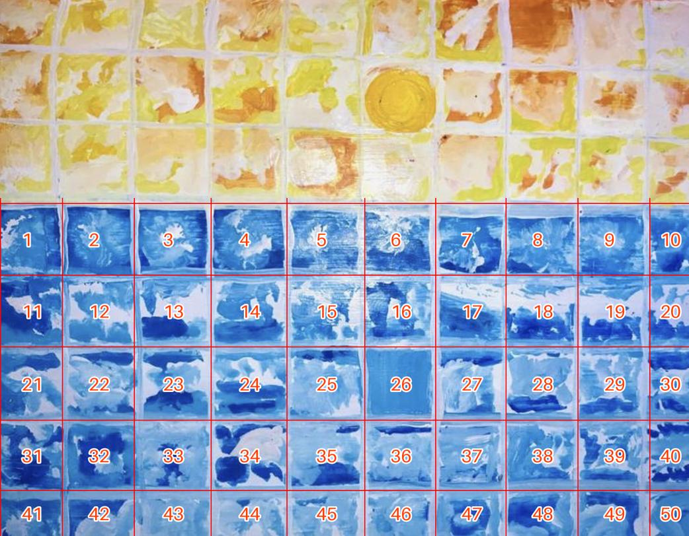

# Reel 3: "Only one is still"

Painting: **Sunset (2) – Finding Meaning in the Now**
Format: same family as Reel 2. The painting comes alive, short cut-letter cards, one transformation moment, then a cream paper end card with the rose logo.
Length: 30 s (about 35 s if a second book quote is added). Plus a 10 s quick cut, like Reel 2.
Size: 1080x1920, used on both Instagram and Pinterest.
Status: **DRAFT FOR DELLA'S APPROVAL. Nothing is edited yet.**

## The idea in one line

There are 50 boxes of sea, and 49 of them are moving water. Box 26, right under the sun, is flat and calm. The reel lets the viewer find it. Then it says what that box means: grace, and change that comes through being, not resisting.

*50 sea boxes in the photo (10 across, 5 down). Box 26 is the still one, straight under the sun.*

## Why this shape (creative math)

- **The contradiction:** a reel needs motion in every beat to stop the scroll, but this painting's message is stillness.
- **TRIZ, separation in space:** 49 boxes ripple and 1 doesn't. The stillness becomes the pattern interrupt, so motion and message stop fighting.
- **TRIZ, separation in time:** at 21 s the score drops to one held note. The sound goes still when the picture does.
- **Turn the constraint into the feature:** the painting's own grid is the edit. Every beat is the boxes doing something new: peeling off, sealing, popping, waving. No new footage is needed except the dress photo.
- **Prior action:** one render serves the 30 s reel, the 10 s quick cut and Pinterest. Cards stay inside y 230 to 1440, which both apps show.

## Viral check

- **Formula:** The Reveal (#24) with a number as the marker (#23). It's a "find the one" puzzle, which gets people to look again and rewatch.
- **Hook scores** (`hookscore.py`):

| Hook | Score |
|---|---|
| **50 boxes of sea. Only one is still.** | **66 OK (chosen)** |
| You'll miss the one still box. Look again. | 62 OK |
| I painted the sea until it broke into boxes. | 49 weak |
| Every box looks the same. None of them are. | 39 weak |
| I put the ocean in boxes. | 34 weak |

- **Honest note:** this formula comes from the library, not from fresh research. That research needs your screenshots of 6 to 12 accounts' Reels tabs, and you can send them whenever you like. No tool guarantees reach. The shape just raises the odds.

## Shot list

Cards are cut-letter tiles in the painting's own colours (sea blue, sun yellow, orange, white paper). They are 64 px or larger, 8 words or fewer, and stay up for at least 2 s. There is no black anywhere: everything sits on the painting or on cream paper.

| Sec | Picture | Card | Voice |
|---|---|---|---|
| 0–2 | Frame 1 is already moving. It shows the vertical strip of the painting with the sun at the top and box 26 below it. Every sea box shimmers, each at its own pace. Box 26 doesn't move. | **50 boxes of sea.** | Fifty boxes of sea. |
| 2–4 | Slow push toward box 26. A thin white paper edge glows around it. | **Only one is still.** | Only one is still. |
| 4–7 | Pull back and drift up to the sun. | **It began with a dream of the sea.** | I dreamt of a woman at the edge of the sea. |
| 7–10 | The white grid lines peel off like paper tape, and for a moment the sea is one open ocean with no boxes. | none | I painted the sea from where she stood, until it turned abstract. |
| 10–13.5 | The tape strips drop back one line at a time and seal every box again. | **So I kept the colours in boxes.** | So I took the colours and contained them carefully in boxes. |
| 13.5–16.5 | Boxes pop forward one by one, each with its own small tilt (a new movement every 0.3 s). | **Each one is its own.** | They look the same. Each one is its own. |
| 16.5–21 | All 49 moving boxes ripple together in one wave across the grid, in line with the ocean. | **[BOOK QUOTE 1, card version]** | [BOOK QUOTE 1] |
| 21–26 | Everything slows down. The score falls to one held note. The camera sinks into box 26 until its calm blue fills the screen, and the sun's reflection glows inside it. | **Change comes through being, not resisting.** | The still one is grace. Change comes through being, not resisting. |
| 26–28.5 | The dress (photo 3, model cut out with a white paper border, no lilac set) rises out of box 26. Sea boxes tile in around her. | **Finding meaning in the now.** | Finding meaning in the now. |
| 28.5–30 | Cream paper end card with the rose logo sticker and "Della Antony" in cut letters. The 50 boxes reassemble small underneath, then ripple back into frame 1 so the reel loops. | **Della Antony** | (score only) |

Optional 35 s version: after 21–26 s, add 4 s on box 26 (calm blue) with **[BOOK QUOTE 2]** as both the card and the voice.

## Sound

- **Voice:** yours, recorded on your phone (script in `narration.txt`). No AI voice.
- **Score:** an original piece built the same way as Reel 2's (`reel2/score.py`), with soft harp ripples and small bells, like light on water. At 21 s it falls to one held bell for box 26, then opens up warmly for the dress.
- **Mix:** about -16 to -17 LUFS, true peak under -4 dBFS. Your voice sits clearly on top.

## What I need from you

1. **The book lines.** Paste the painting narration and 3 to 5 water quotes from the BHTB project. Quote 1 should be 12 words or fewer when spoken. If a quote runs longer, I'll suggest a shorter card version and you choose.
2. **A better photo of the painting.** The current one is 1390 x 1083 and goes soft when box 26 fills the screen. Please take it straight on, in daylight, with no flash and the whole canvas in frame. Send the original file through Drive or email, because WhatsApp shrinks it.
3. **Check the count on the real canvas.** The photo shows 50 sea boxes, but its edges may be cropped. The hook has to be true.
4. **The dress photo.** Is it AI-made? If it is, the caption will say so.
5. **After you approve this:** record the narration in a quiet room with the phone about 20 cm away, one take per line.

## Not doing (your rules)

No text baked into images. No black background. No pink-dominant frames, neon or gradients. No accordion. No naming the book's title. Nothing is posted by me, ever.
